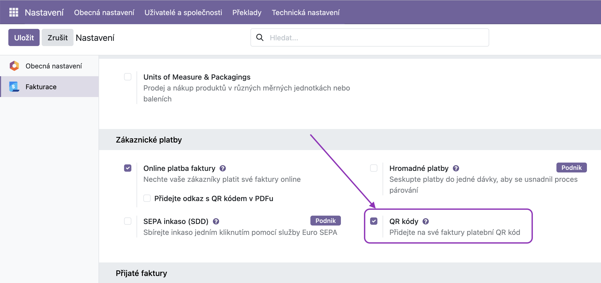
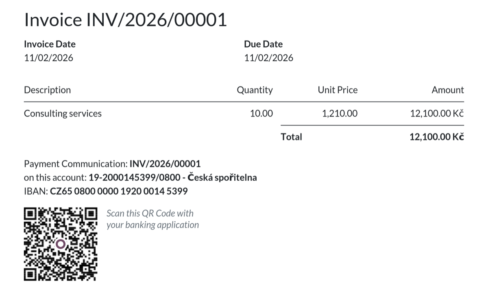

🇬🇧 [English version](README.md)

# QR platby v českém prostředí (QR Platba)

Modul přidává na vydané faktury v CZK český platební **QR kód** (formát SPAYD). Zákazník ho naskenuje v libovolné české bankovní aplikaci a platba se mu vyplní sama: účet, částka, variabilní symbol, splatnost a zpráva pro příjemce.

QR kód je standardní platební QR metoda Odoo (stejně jako SEPA QR kód), takže se zobrazí na obvyklém místě v PDF faktury i v zákaznickém portálu a lze ho vybrat v poli **QR kód platby** na faktuře (záložka Další informace).

> **Bankovní účet jako IBAN.** Bankovní účet společnosti zadejte ve formátu IBAN (např. `CZ65 0800 0000 1920 0014 5399`): QR kód ho vyžaduje a s českým formátem `123-456/0800` faktura QR kód nedostane. Odběratelé přesto uvidí obvyklé číslo účtu: modul rozšiřuje standardní šablonu faktury tak, že vytiskne číslo v českém formátu odvozené z IBANu (např. `19-2000145399/0800`) a na dalším řádku IBAN. Viz [Bankovní účet na faktuře](#bankovní-účet-na-faktuře).

> **Upgradujete?** Před upgradem si přečtěte [Přechod z verze 19.0.1.x](#přechod-z-verze-1901x). Pokud tisknete faktury z kopie šablony faktury (např. zduplikované ve Studiu), přečtěte si i [Kopie šablony faktury](#kopie-šablony-faktury-např-studio): aktualizace modulu se do kopie nepropíší.

## Nastavení

1. **Zapněte QR kódy:** Fakturace > Konfigurace > Nastavení > **QR kódy**.

2. **Zadejte bankovní účet ve formátu IBAN**, např. `CZ65 0800 0000 1920 0014 5399`, v Kontakty > Konfigurace > Bankovní účty nebo ve svém bankovním deníku (**Číslo bankovního účtu**). Český formát `123-456/0800` není podporován, faktura ho ale vytiskne sama (viz [Bankovní účet na faktuře](#bankovní-účet-na-faktuře)). IBAN najdete ve svém internetovém bankovnictví nebo ho spočítáte [kalkulačkou České národní banky](https://www.cnb.cz/cs/platebni-styk/iban/kalkulator-iban-ceska-republika/).
3. **Označte účet jako důvěryhodný:** v bankovním účtu zapněte **Odesílání peněz**.
4. **Více bankovních účtů:** u každého nastavte **Měnu**. Nová faktura dostane jako **Banku příjemce** první důvěryhodný účet ve své měně (nebo bez měny); zkontrolujete ji na faktuře, na záložce Další informace.

## Co QR kód obsahuje

* IBAN účtu příjemce z faktury a zbývající částku k úhradě v CZK
* Datum splatnosti a platební referenci jako zprávu pro příjemce
* Variabilní symbol: číslice z čísla faktury (např. z INV/2026/00001 vznikne 202600001). QR Platba povoluje nejvýš 10 číslic, proto číslujte faktury tak, aby jich měly nejvýš 10.

QR kód se zobrazuje jen na neuhrazených fakturách v CZK. Na dobropisech a uhrazených fakturách se nezobrazuje.

## Bankovní účet na faktuře

Pod částí "Platební komunikace" Odoo standardně tiskne číslo účtu ve formátu IBAN. Náš modul místo toho vytiskne číslo účtu v českém formátu a IBAN na dalším řádku, aby mohli ručně zaplatit čeští i zahraniční odběratelé:



Český formát se z IBANu odvozuje podle vyhlášky ČNB č. 169/2011 Sb., takže obě čísla vždy označují stejný účet jako QR kód. Účty se zahraničním IBANem se tisknou jako u standardního Odoo.

## Kopie šablony faktury (např. Studio)

Do kopie šablony faktury (např. z Odoo Studio, obvykle `account.report_invoice_document_copy_1`) aktualizace modulu změny nepropíší. Šablonu je v takovém případě potřeba upravit ručně.

Lze to udělat v režimu vývojáře: Nastavení > Technická nastavení > Uživatelské rozhraní > Zobrazení, otevřete šablonu a změňte její **Architekturu**. Měňte jen části popsané v následujících bodech a výsledek zkontrolujte vytištěním faktury.

### 1. Kopie z verze 19.0.1.x

Kopie stále obsahuje starý blok QR kódu a tisk selže s chybou „'account.move' object has no attribute 'get_cz_qr_code_base64'“. V architektuře:

1. smažte starý blok QR kódu:
   ```xml
   <t t-set="cz_qr_base64" t-value="o.get_cz_qr_code_base64()"/>

   <t t-if="cz_qr_base64">
       <div id="qrcode" class="d-flex mb-3 avoid-page-break-inside">
           <div class="qrcode me-3">
               
           </div>
           <div class="d-inline text-muted lh-sm fst-italic">
               <p class="fw-bold mb-0" style="color: black;">QR Platba</p>
               <p>Scan this QR Code with<br/>your banking application</p>
           </div>
       </div>
   </t>
   ```
2. následující `<div id="qrcode" … t-if="o.display_qr_code and o.amount_residual">` je obalený značkami `<t t-else="">` a `</t>`: tyto dvě značky odstraňte, samotný div ponechte. Tento div tiskne funkční QR kód.

### 2. České číslo účtu v kopii

Kopie vytvořená předtím, než jste nainstalovali tuto verzi modulu, tiskne jen IBAN. Nahraďte tuto část:

```xml
<t t-if="o.partner_bank_id">
    <br/> on this account: <span t-field="o.partner_bank_id" class="fw-bold"/>
</t>
```

touto:

```xml
<t t-if="o.partner_bank_id">
    <br/> on this account: <span t-if="not o.partner_bank_id._get_cz_acc_number()" t-field="o.partner_bank_id" class="fw-bold"/>
    <t t-else="">
        <span class="fw-bold"><span class="text-nowrap" t-out="o.partner_bank_id._get_cz_acc_number()"/><t t-if="o.partner_bank_id.bank_id"> - <t t-out="o.partner_bank_id.bank_id.name"/></t></span>
        <br/>IBAN: <span class="fw-bold text-nowrap" t-field="o.partner_bank_id.acc_number"/>
    </t>
</t>
```

Text „on this account:“ zůstává beze změny, takže se zachová i jeho překlad.

### 3. Před odinstalací modulu (Odoo 20)

Kopie, která obsahuje `_get_cz_acc_number`, po odinstalaci modulu nejde vytisknout. Před odinstalací do ní vraťte původní část: blok z případu 2 nahraďte prvním úryvkem z případu 2.

## Přechod z verze 19.0.1.x

Verze 19.0.2.x nahrazuje vlastní QR kód modulu standardní QR metodou Odoo. Před upgradem projděte body níže. Pokud na to teď nemáte čas, zůstaňte na verzi 19.0.1.0.0 a soubory modulu zatím neměňte. Tato verze zůstává ke stažení jako tag [ash_cz_qr_payment-19.0.1.0.0](https://github.com/ash-technology/l10n_cz_extra/releases/tag/ash_cz_qr_payment-19.0.1.0.0).

### Odkud se bere bankovní účet

| | 19.0.1.x | 19.0.2.x |
|---|---|---|
| Účet | první bankovní účet společnosti v CZK (nebo bez měny); účet na faktuře verze ignorovala | Účet vytištěný na faktuře |
| Formát účtu | český formát `123-456/0800` modul sám převedl na IBAN | musí být zadaný jako **IBAN**; s českým formátem faktura QR kód nedostane. Faktura český formát dál tiskne, viz [Bankovní účet na faktuře](#bankovní-účet-na-faktuře) |
| Odesílání peněz | nekontrolovalo se | nutné: fakturu s nedůvěryhodným účtem společnosti Odoo nezpracuje a automatické procesy takový účet z faktury odeberou, takže QR kód nedostane |

Co udělat:

1. Otevřete bankovní účet společnosti, buď z bankovního deníku (Fakturace > Konfigurace > Účetní deníky > váš bankovní deník > **Číslo bankovního účtu**), nebo v Kontakty > Konfigurace > Bankovní účty, a ve stejném záznamu přepište číslo na IBAN. Nezakládejte nový účet: faktury, které tento účet už používají, pak IBAN dostanou taky. IBAN najdete ve svém internetovém bankovnictví nebo ho spočítáte [kalkulačkou České národní banky](https://www.cnb.cz/cs/platebni-styk/iban/kalkulator-iban-ceska-republika/).
2. Na účtu zapněte **Odesílání peněz**.
3. Pokud má společnost víc bankovních účtů, nastavte u každého **Měnu**, aby faktury v CZK dostaly jako Banku příjemce účet v CZK.
4. Zkontrolujte, že jsou zapnuté **QR kódy** (Fakturace > Konfigurace > Nastavení). Verze 19.0.1.x tiskla QR kód bez ohledu na toto nastavení; když je vypnuté, faktury QR kód nedostanou.
5. U neuhrazených faktur vytvořených před upgradem zkontrolujte **Banku příjemce** (záložka Další informace): faktury si ponechávají účet, se kterým vznikly.
6. Pokud tisknete faktury z kopie šablony faktury, opravte ji podle [Kopie šablony faktury](#kopie-šablony-faktury-např-studio) (případy 1 a 2).

### Další změny

* QR kód se řídí nastavením **QR kódy** a tiskne se jen na neuhrazených vydaných fakturách v CZK. Verze 19.0.1.x ho tiskla na každou fakturu v CZK, i na dobropisy, uhrazené faktury a přijaté faktury.
* Variabilní symbol je dál jen z číslic, ale nově se bere z čísla faktury místo z platební reference a nezkracuje se na 10 číslic (je chování převzaté z Odoo 20, takže po upgrade nebudete muset měnit nastavení). Při výchozím nastavení deníku, kdy je platební reference číslo faktury, se nic nemění. Liší se, když je platební reference podle zákazníka nebo ručně upravená, a když má číslo faktury víc než 10 číslic (např. `2026/10/00001`). QR Platba povoluje nejvýš 10 číslic, číslování faktur s tím musí být v souladu.
* Kód nově obsahuje i datum splatnosti, platební referenci jako zprávu pro příjemce (nejvýš 60 znaků) a jméno příjemce.
* Už odeslané faktury si ponechávají své PDF, včetně starého QR kódu.

### Jak upgradovat

Vyměňte soubory modulu a hned modul upgradujte (Aplikace > Upgrade, nebo restart Odoo s `-u ash_cz_qr_payment`): mezi těmito kroky tisk faktur selhává. Odoo.sh modul upgraduje samo, když do repozitáře nahrajete novou verzi.

## Často kladené dotazy (FAQ)

**QR kód se na faktuře negeneruje**
Otevřete fakturu, na záložce Další informace vyberte v poli **QR kód platby** hodnotu **QR Platba**. Odoo vám pak napíše, co chybí (např. účet není ve formátu IBAN nebo faktura není v CZK).

**Tisk faktury selže s chybou „'account.move' object has no attribute 'get_cz_qr_code_base64'“**
Vaše šablona faktury je kopie z verze 19.0.1.x. Viz [Kopie šablony faktury](#1-kopie-z-verze-1901x), případ 1.

**Faktura tiskne jen IBAN, ne české číslo účtu**
Buď Banka příjemce faktury není český IBAN (začínající CZ), nebo tisknete faktury z kopie šablony faktury. Viz [Kopie šablony faktury](#2-české-číslo-účtu-v-kopii), případ 2.

**Na faktuře je QR kód, který otevře webovou stránku**
To je jiná funkce: QR kód pro online platbu přes zákaznický portál (platební brány). Zapíná ho nastavení **Přidejte odkaz s QR kódem v PDFu** a s tímto modulem nesouvisí.

**Odoo 20**
Odoo 20 obsahuje stejnou funkcionalitu přímo v české lokalizaci. Při přechodu na Odoo 20 tento modul odinstalujte. Odoo 20 tiskne na faktuře jen IBAN; české číslo účtu je funkce tohoto modulu a s ním zmizí. Pokud tisknete faktury z kopie šablony faktury, přečtěte si před odinstalací [Kopie šablony faktury](#3-před-odinstalací-modulu-odoo-20), případ 3.

---

## O modulu

Tento modul je vyvíjen a spravován společností **[Ash technology s.r.o.](https://www.ashtechnology.eu)**, oficiálním partnerem Odoo v České republice.

Kód QR metody je převzatý z metody `czk_qr` modulu `l10n_cz` v Odoo 20.0 Community (© Odoo S.A., LGPL-3) a upravený pro Odoo 19.

Modul je zdarma a open-source. Uvítáme vaši zpětnou vazbu a návrhy na vylepšení – pokud váš nápad pomůže komunitě, rádi ho zapracujeme.

**Kontakt:**
- Web: [www.ashtechnology.eu](https://www.ashtechnology.eu)
- Email: info@ashtechnology.eu

Pro zakázkový vývoj v Odoo nebo větší projekty nás neváhejte kontaktovat.

---

*Odoo je ochranná známka společnosti Odoo S.A.*
