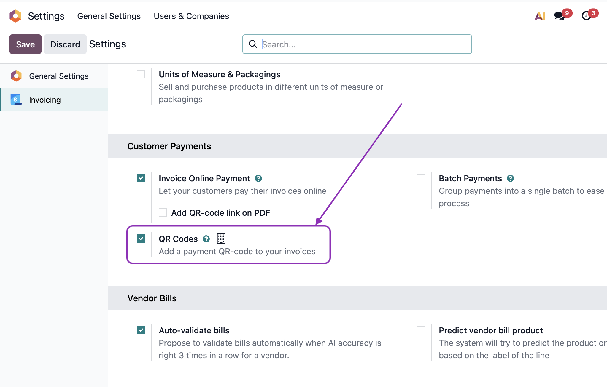
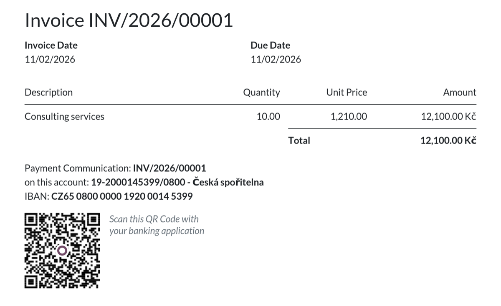

🇨🇿 [Česká verze](README.cs.md)

# Czech QR Payments (QR Platba)

This module adds the Czech **payment QR code** (SPAYD format) to CZK customer invoices. Customers scan it with any Czech banking app and the payment is filled in for them: account, amount, variable symbol, due date and message.

The QR code is a standard Odoo payment QR method (like the SEPA QR code), so it appears in the usual place on the invoice PDF and in the customer portal, and it can be selected in the **Payment QR-code** field of the invoice (Other Info tab).

> **Bank account as IBAN.** Enter your company bank account as IBAN (e.g. `CZ65 0800 0000 1920 0014 5399`): the QR code requires it, and with the Czech format `123-456/0800` the invoice gets no QR code. Your customers still see the familiar account number: the module extends the standard invoice report to print the Czech format derived from the IBAN (e.g. `19-2000145399/0800`), with the IBAN on the next line. See [Bank account on the invoice](#bank-account-on-the-invoice).

> **Upgrading?** Read [Upgrading to version 19.0.3.x](#upgrading-to-version-1903x) (and, from version 19.0.1.x, also [Upgrading from version 19.0.1.x](#upgrading-from-version-1901x)) before you upgrade. If you print invoices with a copy of the invoice report (e.g. duplicated in Studio), read [Copies of the invoice report](#copies-of-the-invoice-report-eg-studio) too: module updates don't reach the copy.

## Setup

1. **Enable QR codes:** Invoicing > Configuration > Settings > **QR Codes**.

2. **Enter your bank account as IBAN**, e.g. `CZ65 0800 0000 1920 0014 5399`, in Contacts > Configuration > Bank Accounts or in your bank journal (**Bank Account Number**). The Czech format `123-456/0800` is not supported, but the invoice prints it for you (see [Bank account on the invoice](#bank-account-on-the-invoice)). You can find your IBAN in your internet banking or calculate it with the [Czech National Bank calculator](https://www.cnb.cz/cs/platebni-styk/iban/kalkulator-iban-ceska-republika/).
3. **Trust the account:** in the bank account, enable **Send Money**.
4. **Several bank accounts:** set the **Currency** of each. A new invoice gets the first trusted account in its currency (or without a currency) as the **Recipient Bank**; you can check it on the invoice, in the Other Info tab.
5. **Variable symbol:** on each sales journal, set **Communication Standard** to **Numbers only** (Invoicing > Configuration > Journals > the journal > Advanced Settings). The payment reference of the invoices is then made of the digits of the invoice number (or of the customer reference with the Communication Type **Based on Customer**), and it is used as the variable symbol.

## What is in the QR code

* IBAN of the invoice's Recipient Bank and the amount due in CZK
* Due date
* Variable symbol: the **Payment Reference** of the invoice, as it is. On customer invoices it is filled when the invoice is posted, according to the journal setting (see [Setup](#setup), point 5); you can change it, e.g. to a contract number. On vendor bills, enter the vendor's variable symbol there. QR Platba allows only digits, at most 10.
* Message: the invoice number; on vendor bills and on customer credit notes, the **Bill Reference** (the vendor's invoice number)
* Recipient name

The QR code is shown only on unpaid CZK invoices. It is not shown on credit notes and on paid invoices.

When you register a payment of a CZK vendor bill (or a refund of a customer credit note), Odoo shows the QR code in the payment dialog too, so you can pay it from your banking app. It needs the vendor's account as an IBAN with **Send Money** enabled. A payment of several bills at once gets a QR code without the variable symbol and the due date.

## Bank account on the invoice

Under "Payment Communication", Odoo by default prints the account number as an IBAN. Our module prints the account number in the Czech format instead and the IBAN on the next line, so that both Czech and foreign customers can pay by hand:



The Czech format is taken from the IBAN according to CNB Decree No. 169/2011 Coll., so both always identify the same account as the QR code. Accounts with a foreign IBAN are printed as in standard Odoo.

## Copies of the invoice report (e.g. Studio)

Module updates don't propagate changes to a copy of the invoice report (e.g. from Odoo Studio, typically `account.report_invoice_document_copy_1`). The report then has to be edited manually.

You can do it in developer mode: Settings > Technical > User Interface > Views, open the report and change its **Architecture**. Change only the parts described in the following points and check the result by printing an invoice.

### 1. Copy made with version 19.0.1.x

The copy still contains the old QR code block, and printing fails with "'account.move' object has no attribute 'get_cz_qr_code_base64'". In the architecture:

1. delete the old QR code block:
   ```xml
   <t t-set="cz_qr_base64" t-value="o.get_cz_qr_code_base64()"/>

   <t t-if="cz_qr_base64">
       <div id="qrcode" class="d-flex mb-3 avoid-page-break-inside">
           <div class="qrcode me-3">
               
           </div>
           <div class="d-inline text-muted lh-sm fst-italic">
               <p class="fw-bold mb-0" style="color: black;">QR Platba</p>
               <p>Scan this QR Code with<br/>your banking application</p>
           </div>
       </div>
   </t>
   ```
2. the following `<div id="qrcode" … t-if="o.display_qr_code and o.amount_residual">` is wrapped in `<t t-else="">` and `</t>`: remove these two tags, but keep the div. This div prints the working QR code.

### 2. Czech account number in a copy

A copy made before you installed this version of the module prints only the IBAN. Replace this part:

```xml
<t t-if="o.partner_bank_id">
    <br/> on this account: <span t-field="o.partner_bank_id" class="fw-bold"/>
</t>
```

with:

```xml
<t t-if="o.partner_bank_id">
    <br/> on this account: <span t-if="not o.partner_bank_id._get_cz_acc_number()" t-field="o.partner_bank_id" class="fw-bold"/>
    <t t-else="">
        <span class="fw-bold"><span class="text-nowrap" t-out="o.partner_bank_id._get_cz_acc_number()"/><t t-if="o.partner_bank_id.bank_id"> - <t t-out="o.partner_bank_id.bank_id.name"/></t></span>
        <br/>IBAN: <span class="fw-bold text-nowrap" t-field="o.partner_bank_id.acc_number"/>
    </t>
</t>
```

The text "on this account:" stays as it is, so its translation is kept.

### 3. Before you uninstall the module (Odoo 20)

A copy that contains `_get_cz_acc_number` fails to print once the module is uninstalled. Before you uninstall it, put the original part back: replace the block from case 2 with the first snippet of case 2.

## Upgrading to version 19.0.3.x

Version 19.0.3.x takes the variable symbol from the **Payment Reference** of the invoice, without changes, instead of the digits of the invoice number. This fixes vendor bills: the QR code in the payment dialog had the digits of your internal bill number as the variable symbol and the vendor's variable symbol as the message.

What to do:

1. On each sales journal for CZK invoices, set **Communication Standard** to **Numbers only** (Invoicing > Configuration > Journals > the journal > Advanced Settings). With the default **Full Reference**, the payment reference is e.g. `INV/2026/00001`, which is not a valid variable symbol: banking apps reject the QR code or ignore the variable symbol.
2. The setting applies to invoices posted from then on. Unpaid invoices posted before keep their payment reference: if it is not made of digits only, correct the **Payment Reference** on the invoice before you print or send it again.
3. On vendor bills, the **Payment Reference** must contain the vendor's variable symbol and the **Bill Reference** the vendor's invoice number.

Other changes:

* The message is the invoice number on customer invoices (no longer the payment reference) and the Bill Reference on vendor bills and customer credit notes.
* The QR code always uses the data of the invoice being paid. Previously, the invoice was searched by the payment reference, so with the same reference on several invoices (e.g. a contract number) the due date could come from another invoice.
* This differs from Odoo 20, see [FAQ](#frequently-asked-questions-faq), Odoo 20.

If you upgrade from version 19.0.1.x, go through the next section too; its note on the variable symbol is replaced by this section.

## Upgrading from version 19.0.1.x

Version 19.0.2.x replaces the module's own QR code with the standard Odoo QR method. Go through the points below before you upgrade. If you can't do it now, stay on 19.0.1.0.0 and don't replace the module files yet; that version stays available as the tag [ash_cz_qr_payment-19.0.1.0.0](https://github.com/ash-technology/l10n_cz_extra/releases/tag/ash_cz_qr_payment-19.0.1.0.0).

### Where the bank account comes from

| | 19.0.1.x | 19.0.2.x |
|---|---|---|
| Account | the first company bank account in CZK (or without a currency); version 19.0.1.x ignored the account on the invoice | the account printed on the invoice |
| Account format | the Czech format `123-456/0800` was converted to IBAN by the module | must be entered as **IBAN**; with the Czech format, the invoice gets no QR code. The invoice still prints the Czech format, see [Bank account on the invoice](#bank-account-on-the-invoice) |
| Send Money | not checked | required: Odoo does not process an invoice with an untrusted company account, and automated processes remove such an account from the invoice, so it gets no QR code |

What to do:

1. Open the company bank account, either from your bank journal (Invoicing > Configuration > Journals > your bank journal > **Bank Account Number**) or in Contacts > Configuration > Bank Accounts, and replace the number with the IBAN in the same record. Don't create a new account: invoices that already use this account then get the IBAN too. You can find the IBAN in your internet banking or calculate it with the [Czech National Bank calculator](https://www.cnb.cz/cs/platebni-styk/iban/kalkulator-iban-ceska-republika/).
2. Enable **Send Money** on the account.
3. If the company has several bank accounts, set the **Currency** of each, so that CZK invoices get the CZK account as the Recipient Bank.
4. Make sure **QR Codes** is enabled (Invoicing > Configuration > Settings). Version 19.0.1.x printed the QR code regardless of this setting; without it the invoices get no QR code.
5. On unpaid invoices created before the upgrade, check the **Recipient Bank** (Other Info tab): invoices keep the account they were created with.
6. If you print invoices with a copy of the invoice report, fix it as described in [Copies of the invoice report](#copies-of-the-invoice-report-eg-studio) (cases 1 and 2).

### Other changes

* The QR code follows the **QR Codes** setting and is printed only on unpaid customer invoices in CZK. Version 19.0.1.x printed it on every CZK invoice, including credit notes, paid invoices and vendor bills.
* The variable symbol is still made of digits only, but it is now taken from the invoice number instead of the payment reference, and it is not shortened to 10 digits (this behavior is taken from Odoo 20, so you won't have to change any settings after the upgrade). With the default journal setting, where the payment reference is the invoice number, nothing changes. It differs when the payment reference is based on the customer or edited by hand, and when the invoice number has more than 10 digits (e.g. `2026/10/00001`). QR Platba allows at most 10 digits, so your invoice numbering must comply with that.
* The code also contains the due date, the payment reference as the message (up to 60 characters) and the recipient name.
* Invoices that were already sent keep their PDF, including the old QR code.

### How to upgrade

Replace the module files and upgrade the module right away (Apps > Upgrade, or restart Odoo with `-u ash_cz_qr_payment`): between these two steps, printing invoices fails. Odoo.sh upgrades the module automatically when you push the new version to the repository.

## Frequently Asked Questions (FAQ)

**The QR code is not generated on the invoice**
Open the invoice, go to the Other Info tab and select **CZK QR** in the **Payment QR-code** field. Odoo then tells you what is missing (e.g. the account is not an IBAN or the invoice is not in CZK).

**Printing the invoice fails with "'account.move' object has no attribute 'get_cz_qr_code_base64'"**
Your invoice report is a copy made with version 19.0.1.x. See [Copies of the invoice report](#1-copy-made-with-version-1901x), case 1.

**The invoice shows only the IBAN, not the Czech account number**
Either the Recipient Bank of the invoice is not a Czech IBAN (starting with CZ), or you print invoices with a copy of the invoice report. See [Copies of the invoice report](#2-czech-account-number-in-a-copy), case 2.

**The invoice shows a QR code that opens a web page**
That is a different feature: the QR code for paying online via the customer portal (payment providers). It is enabled by the **Add QR-code link on PDF** setting and does not depend on this module.

**Odoo 20**
Odoo 20 contains the same QR method in its Czech localization, except for the variable symbol and the message: Odoo 20 makes the variable symbol of the digits of the invoice number and uses the payment reference as the message, also on vendor bills. When you migrate to Odoo 20, uninstall this module, unless you need its variable symbol and message. Odoo 20 prints only the IBAN on the invoice; the Czech account number is a feature of this module and disappears with it. If you print invoices with a copy of the invoice report, see [Copies of the invoice report](#3-before-you-uninstall-the-module-odoo-20), case 3, before you uninstall the module.

---

## About

This module is developed and maintained by **[Ash technology s.r.o.](https://www.ashtechnology.eu)**, an official Odoo partner based in the Czech Republic.

The code of the QR method is taken from the `czk_qr` method of the `l10n_cz` module of Odoo 20.0 Community (© Odoo S.A., LGPL-3), adapted to Odoo 19 and changed in the variable symbol and the message (see [Upgrading to version 19.0.3.x](#upgrading-to-version-1903x)).

These modules are free and open-source. We welcome your feedback and feature requests – if your idea benefits the community, we're happy to include it.

**Contact us:**
- Web: [www.ashtechnology.eu](https://www.ashtechnology.eu)
- Email: info@ashtechnology.eu

For custom Odoo development or larger projects, feel free to reach out.

---

*Odoo is a trademark of Odoo S.A.*
